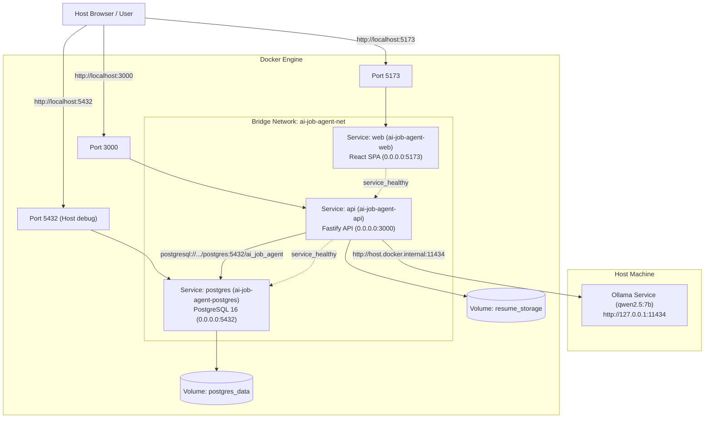

# AI Job Agent

A local-first, AI-powered Job Search and Job Application Agent built with TypeScript, React, Fastify, PostgreSQL, and Prisma in a modern pnpm monorepo.

---

## 📌 Project Purpose

The goal of **AI Job Agent** is to provide an intelligent, privacy-preserving, local-first assistant that streamlines the end-to-end job discovery and application lifecycle:
- Parsing and structuring the user's resume and professional profile locally.
- Discovering relevant job postings across sources based on role preferences.
- Evaluating job descriptions and computing explainable AI match scores.
- Generating hyper-tailored answers and cover letters grounded strictly in real user experience.
- Assisting in application completion with human-in-the-loop approval before final submission.

> **Note**: This repository follows a strict incremental development philosophy.
> - **Milestone 1**: Initial monorepo foundation, basic Fastify API health check, and React system status frontend.
> - **Milestone 2**: Docker & Docker Compose foundation with multi-stage builds, container health checks, and isolated bridge networking.
> - **Milestone 3**: PostgreSQL persistence foundation with Prisma ORM, core user profile schema, migrations, and database health probes.
> - **Milestone 4 (Current)**: Resume Upload and User Profile Management with PDF/DOCX text extraction, versioning, local file storage, and interactive React dashboard.

---

## 🏗️ Current Architecture

The codebase is organized as a lightweight, clean **pnpm workspace monorepo** with containerization and database support:

- **`apps/web`**: Single-Page Application (SPA) built with React 18, Vite, and Tailwind CSS. Features Profile Editor, Drag-and-Drop Resume Uploader, and Version History.
- **`apps/api`**: Fastify REST API built with Node.js and TypeScript, configured with Prisma ORM, `@fastify/multipart`, PDF/DOCX parsing services, and container-ready networking (`0.0.0.0:3000`).
- **`packages/shared`**: Shared TypeScript package containing common contracts, types, and data models used across backend and frontend workspaces.
- **`docker-compose.yml`**: Orchestrates `postgres`, `api`, and `web` containers over a private bridge network (`ai-job-agent-net`) with persistent storage for database (`postgres_data`) and uploaded resumes (`resume_storage`).

```
AI Job Agent/
├── apps/
│   ├── api/                     # Fastify backend service
│   │   ├── prisma/
│   │   │   ├── migrations/      # Version-controlled SQL migrations
│   │   │   └── schema.prisma    # PostgreSQL Prisma schema & models
│   │   ├── src/
│   │   │   ├── config/env.ts    # Centralized environment configuration
│   │   │   ├── db/prisma.ts     # Reusable Prisma singleton client
│   │   │   ├── routes/
│   │   │   │   ├── health.ts    # GET /health with DB status
│   │   │   │   ├── profile.ts   # GET & PUT /profile
│   │   │   │   └── resume.ts    # POST, GET /profile/resumes
│   │   │   ├── services/
│   │   │   │   ├── health.service.ts
│   │   │   │   ├── profile.service.ts
│   │   │   │   └── resume/
│   │   │   │       ├── resume.service.ts
│   │   │   │       └── resume-parser.service.ts
│   │   │   ├── server.ts        # Fastify server instance, CORS & multipart
│   │   │   └── index.ts         # Entry point & graceful shutdown
│   │   ├── .env.example
│   │   ├── Dockerfile           # Multi-stage Dockerfile with Prisma & storage
│   │   ├── package.json
│   │   └── tsconfig.json
│   └── web/                     # React + Vite frontend
│       ├── src/
│       │   ├── api/             # Typed API client abstraction
│       │   │   ├── client.ts    # Base HTTP client with error handling
│       │   │   ├── profile.ts   # Profile API methods
│       │   │   └── resume.ts    # Resume API methods
│       │   ├── App.tsx          # System Status, Profile Form, Resume Uploader
│       │   ├── index.css        # Tailwind styles & dark mode
│       │   ├── main.tsx         # React DOM mount
│       │   └── vite-env.d.ts
│       ├── .env.example
│       ├── Dockerfile           # Multi-stage Dockerfile for Web
│       ├── index.html
│       ├── package.json
│       ├── postcss.config.js
│       ├── tailwind.config.js
│       ├── tsconfig.json
│       └── vite.config.ts
├── packages/
│   └── shared/                  # Cross-workspace shared types
│       ├── src/
│       │   ├── index.ts
│       │   ├── types/health.ts  # HealthCheckResponse definition
│       │   ├── types/profile.ts # UserProfileResponse, UpdateProfileRequest
│       │   └── types/resume.ts  # ResumeResponse, ResumeListResponse
│       ├── package.json
│       └── tsconfig.json
├── .dockerignore
├── .env.example                 # Root environment template
├── .gitignore
├── docker-compose.yml           # Multi-container orchestration (postgres, api, web)
├── package.json                 # Monorepo root manifest & scripts
├── pnpm-workspace.yaml          # Monorepo workspace configuration
├── tsconfig.json
└── README.md                    # Project documentation
```

---

## 🛠️ Technology Stack

### Current Foundation
- **Database**: [PostgreSQL 16](https://www.postgresql.org/) (Alpine)
- **ORM & Migrations**: [Prisma 6](https://www.prisma.io/)
- **Document Text Extraction**: [unpdf](https://github.com/unjs/unpdf) (PDF), [mammoth](https://github.com/mwilliamson/mammoth.js) (DOCX)
- **Multipart Form Uploads**: [@fastify/multipart](https://github.com/fastify/fastify-multipart)
- **Containerization**: [Docker](https://www.docker.com/) & [Docker Compose](https://docs.docker.com/compose/)
- **Monorepo & Package Manager**: [pnpm](https://pnpm.io/) workspaces
- **Language**: [TypeScript](https://www.typescriptlang.org/) (strict mode across all packages)
- **Frontend**: [React 18](https://react.dev/), [Vite 6](https://vitejs.dev/), [Tailwind CSS 3](https://tailwindcss.com/)
- **Backend**: [Fastify 5](https://fastify.dev/), [Node.js](https://nodejs.org/) (v22 Alpine)
- **Runtime Tooling & Testing**: [tsx](https://github.com/privatenumber/tsx), `node:test`

### Future Milestone Technologies
- **In-Memory Cache & Queues**: Redis, BullMQ
- **Vector Search & Embeddings**: Qdrant
- **Local AI Execution**: Ollama (Llama 3, DeepSeek, Mistral)
- **Agent Orchestration**: LangGraph
- **Browser Automation**: Playwright

---

## 📄 Resume Upload & Text Extraction

### Supported Formats & File Constraints
- **Accepted Formats**: `PDF` (`.pdf`) and `DOCX` (`.docx`).
- **Rejected Formats**: `.exe`, `.zip`, `.rar`, images (`.png`, `.jpg`), videos, and arbitrary binaries.
- **Maximum File Size**: `10 MB` (Configurable via `MAX_RESUME_SIZE_MB`).
- **File Validation**: Enforced via file extension, MIME type, and streaming byte thresholds.

### Text Extraction Pipeline
When a resume is uploaded:
1. **PDF**: Extracted into clean text using `unpdf` (native pdf.js extraction without external binary dependencies).
2. **DOCX**: Extracted into plain text using `mammoth` (extracts raw text blocks, stripping formatting tags).
3. The extracted plain text is saved directly to `Resume.rawText` in PostgreSQL for future semantic search, keyword scoring, and LLM context injection.

### Resume Versioning Strategy
- Each upload increments the version sequentially:
  - First resume uploaded: `version = 1`
  - Subsequent uploads: `version = latest_version + 1`
- Historical resumes are **never overwritten or deleted**, ensuring an audit trail of user iterations.
- The latest resume is identifiable via `orderBy: { version: 'desc' }`.

### Security & Local Storage
- Uploaded binary files are **never stored in PostgreSQL**.
- Stored on the local filesystem under `UPLOAD_DIR` (`storage/resumes` locally, `/app/storage/resumes` in Docker).
- **Sanitized Filenames**: Saved using a cryptographically random UUID prefix (`${uuid}-${sanitized_name}`) to prevent path traversal (`../`) and filename collision attacks.
- Backed by a dedicated Docker named volume (`resume_storage`).

---

## 🌐 API Documentation

### Profile Endpoints

#### 1. Retrieve Current Profile
- **`GET /profile`**
- **Response**: `200 OK` (or `404 Not Found` if no profile exists)
```json
{
  "id": "bbd54d32-0c01-477b-b1d4-b0c450a7279d",
  "fullName": "Jane Doe",
  "email": "jane.doe@example.com",
  "phone": "+1 555-0199",
  "professionalSummary": "Full Stack Engineer with 7 years of experience in TypeScript and distributed systems.",
  "currentTitle": "Senior Full Stack Engineer",
  "yearsOfExperience": 7,
  "createdAt": "2026-10-04T16:58:16.764Z",
  "updatedAt": "2026-10-04T16:58:48.823Z"
}
```

#### 2. Create or Update Profile
- **`PUT /profile`**
- **Content-Type**: `application/json`
- **Request Body**:
```json
{
  "fullName": "Jane Doe",
  "email": "jane.doe@example.com",
  "phone": "+1 555-0199",
  "currentTitle": "Senior Full Stack Engineer",
  "yearsOfExperience": 7,
  "professionalSummary": "Full Stack Engineer with 7 years of experience..."
}
```
- **Response**: `200 OK` with updated profile payload.

---

### Resume Endpoints

#### 1. Upload Resume
- **`POST /profile/resumes`**
- **Content-Type**: `multipart/form-data`
- **Field Name**: `resume`
- **Response**: `201 Created`
```json
{
  "id": "2e18a9b5-9a6a-4b15-9872-e1f887357085",
  "fileName": "Resume_2026.pdf",
  "version": 2,
  "fileType": "application/pdf",
  "fileSize": 145020,
  "textExtracted": true,
  "createdAt": "2026-10-04T16:59:26.192Z"
}
```

#### 2. Get Resume History
- **`GET /profile/resumes`**
- **Response**: `200 OK`
```json
{
  "resumes": [
    {
      "id": "2e18a9b5-9a6a-4b15-9872-e1f887357085",
      "fileName": "Resume_2026.pdf",
      "version": 2,
      "fileType": "application/pdf",
      "fileSize": 145020,
      "textExtracted": true,
      "createdAt": "2026-10-04T16:59:26.192Z"
    },
    {
      "id": "dc138338-f635-4c07-bb0b-02715f29a5bf",
      "fileName": "Resume_2025.pdf",
      "version": 1,
      "fileType": "application/pdf",
      "fileSize": 142100,
      "textExtracted": true,
      "createdAt": "2026-10-04T16:59:21.302Z"
    }
  ],
  "latestResume": {
    "id": "2e18a9b5-9a6a-4b15-9872-e1f887357085",
    "fileName": "Resume_2026.pdf",
    "version": 2,
    "fileType": "application/pdf",
    "fileSize": 145020,
    "textExtracted": true,
    "createdAt": "2026-10-04T16:59:26.192Z"
  }
}
```

#### 3. Get Resume Metadata by ID
- **`GET /profile/resumes/:id`**
- **Response**: `200 OK` (excludes full raw text for fast lightweight transfers).

#### 4. Inspect Extracted Text (Debug Endpoint)
- **`POST /profile/resumes/:id/analyze`** (Milestone 5)
  - Synchronously triggers Ollama AI extraction from resume `rawText`, validates JSON against schema, and updates normalized PostgreSQL profile data.
  - **Response**: `200 OK`
```json
{
  "resumeId": "2e18a9b5-9a6a-4b15-9872-e1f887357085",
  "status": "analyzed",
  "profile": {
    "professionalSummary": "Senior Full Stack Engineer with 7 years of experience building scalable systems.",
    "currentTitle": "Senior Full Stack Engineer",
    "yearsOfExperience": 7
  },
  "counts": {
    "skills": 14,
    "experience": 3,
    "education": 1,
    "projects": 4,
    "certifications": 2
  }
}
```
  - **Error Codes**:
    - `400`: Resume has no extracted text or exceeds `MAX_AI_RESUME_CHARS`.
    - `404`: Resume ID not found.
    - `422`: AI response failed schema validation.
    - `429`: An AI analysis is already running (CPU concurrency lock).
    - `503`: Ollama service unavailable or model not found.
    - `504`: Ollama request timed out.
    - `500`: Unexpected internal server error.

- **`GET /profile/resumes/:id/text`**
  - **Response**: `200 OK`
```json
{
  "id": "2e18a9b5-9a6a-4b15-9872-e1f887357085",
  "fileName": "Resume_2026.pdf",
  "version": 2,
  "rawText": "Jane Doe\nSenior Full Stack Engineer\nExperience...\nSkills: React, Node.js, PostgreSQL"
}
```

---

## 🤖 Milestone 5: Local AI Resume Understanding (Ollama)

Milestone 5 introduces local, privacy-preserving AI inference to analyze resume text and normalize professional data into PostgreSQL.

### Architecture Flow

```
Resume PDF / DOCX
      │
      ▼
ResumeParserService  ──>  Extracts plain text into Resume.rawText
      │
      ▼
POST /profile/resumes/:id/analyze
      │
      ▼
ResumeAIService (Prompt Injection Guard + Text Size Check)
      │
      ▼
OllamaService  ──>  Ollama HTTP API (qwen2.5:7b on host machine)
      │
      ▼
Structured JSON Response
      │
      ▼
Zod Schema Validation (ResumeAIProfileSchema)
      │
      ▼
PostgreSQL Transaction Persistence (UserProfile, Skill, Experience, Education)
      │
      ▼
200 OK Structured Analysis Summary
```

### 1. Ollama Installation & Setup

1. **Install Ollama**:
   Download and install from [ollama.com](https://ollama.com).
   Verify installation:
   ```bash
   ollama --version
   ```

2. **Pull the Model**:
   Pull `qwen2.5:7b` (optimized for instruction following and structured JSON):
   ```bash
   ollama pull qwen2.5:7b
   ```

3. **Verify Local Models**:
   ```bash
   ollama list
   ```

4. **Run or Test the Model**:
   ```bash
   ollama run qwen2.5:7b "Hello, output valid JSON with status: ok"
   ```

### 2. Environment Variables

| Variable | Default (Docker) | Default (Host Dev) | Description |
|---|---|---|---|
| `OLLAMA_BASE_URL` | `http://host.docker.internal:11434` | `http://127.0.0.1:11434` | Ollama HTTP endpoint |
| `OLLAMA_MODEL` | `qwen2.5:7b` | `qwen2.5:7b` | LLM model identifier |
| `OLLAMA_TIMEOUT_MS` | `120000` | `120000` | Generation timeout in milliseconds (2 mins) |
| `MAX_AI_RESUME_CHARS`| `30000` | `30000` | Character limit for input resume text |

### 3. Docker Host Connectivity

The Fastify API runs inside Docker container `ai-job-agent-api`.
Ollama runs directly on the host machine to leverage local CPU/GPU hardware.

Communication occurs through:
```
http://host.docker.internal:11434
```

In `docker-compose.yml`, `extra_hosts` ensures seamless host gateway resolution across Linux, macOS, and Windows:
```yaml
api:
  extra_hosts:
    - "host.docker.internal:host-gateway"
```

### 4. Database Persistence & Duplicate Prevention
- **UserProfile**: Updates `professionalSummary`, `currentTitle`, and `yearsOfExperience`.
- **Skills**: Persisted into `Skill` table. Normalized by case-insensitive name; updates proficiency/category without creating duplicate records on repeated analysis.
- **Experience**: Synchronized into `Experience` table matching on `(company, jobTitle)`.
- **Education**: Synchronized into `Education` table matching on `(institution, degree)`.
- **Projects & Certifications**: Extracted and returned in structured response (models deferred to future milestones per specification).
- **Source Resume Integrity**: Original uploaded `Resume` record and `rawText` are never mutated.

### 5. Troubleshooting Ollama Connectivity

- **Issue**: `503 Service Unavailable` with message `Could not connect to Ollama`.
  - **Check**: Is Ollama running on your host machine? Verify by running `ollama list` or visiting `http://localhost:11434/api/tags` in your browser.
  - **Check**: On Windows/Linux, verify that Ollama is bound to all interfaces or loopback. By default, Ollama listens on `127.0.0.1:11434`. To allow Docker access on Linux if needed, set environment variable `OLLAMA_HOST=0.0.0.0:11434`.
- **Issue**: `503 Service Unavailable` with message `Ollama model "qwen2.5:7b" was not found`.
  - **Fix**: Run `ollama pull qwen2.5:7b` in your terminal.
- **Issue**: `504 Gateway Timeout`.
  - **Fix**: If running on CPU, the initial cold model load may take longer. Increase `OLLAMA_TIMEOUT_MS=180000` in `.env`.

---

## 🧪 Testing

The repository uses Node's native `node:test` framework executed with `tsx` for fast TypeScript unit and integration testing.

To run all test suites:
```bash
pnpm test
```

### Verified Test Cases (34 Passing Tests):
- **`OllamaService`**: Structured JSON generation, connection failure handling (503), timeout handling (504), missing model handling (503), malformed JSON handling (422), CPU concurrency lock (429), and non-blocking connectivity check.
- **`ResumeAIService`**: Structured extraction with prompt injection defense, empty text rejection (400), text size threshold enforcement (400), schema validation with Zod (422), PostgreSQL database transaction persistence, and duplicate record prevention on re-analysis.
- **`POST /profile/resumes/:id/analyze` Route**: 200 OK integration flow, 404 Not Found for missing resume, 400 Bad Request for unextracted text, 422 for malformed AI output, 503 for Ollama unavailable, 504 for timeout.
- **`ProfileService`**: Profile creation, single-user upsert, profile retrieval.
- **`ResumeParserService`**: PDF text extraction, DOCX text extraction, rejection of invalid extensions (.exe, .zip), rejection of image files (.png), corrupted file handling.
- **`ResumeService`**: 10 MB file size limit enforcement, version incrementation (v1 -> v2), metadata retrieval, and raw text extraction inspection.

---

## 🐳 Docker Architecture & Development

Docker Compose orchestrates three interconnected services:



### Starting the Full Stack
```bash
docker compose up --build
```
*(Or detached in background: `docker compose up -d --build`)*

Once running:
- **Frontend Dashboard**: [http://localhost:5173](http://localhost:5173)
- **Fastify API**: [http://localhost:3000](http://localhost:3000)
- **API Health Endpoint**: [http://localhost:3000/health](http://localhost:3000/health)
- **Job Ingestion API**: [http://localhost:3000/jobs](http://localhost:3000/jobs)

---

## 💼 Milestone 6: Job Discovery + Job Database

Milestone 6 introduces a reliable, normalized, and deduplicated job ingestion and storage foundation.

### 1. Ingestion Pipeline Architecture

```
JOB SOURCES (Manual / API / Feed / Career Page)
    ↓
SOURCE ADAPTERS (JobSourceAdapter, ManualJobAdapter)
    ↓
JOB NORMALIZATION (JobNormalizerService - Deterministic Rules)
    ↓
DEDUPLICATION (JobDeduplicationService - Primary & Fallback Fingerprints)
    ↓
POSTGRESQL (Prisma ORM: JobSource, Job, DiscoveryRun)
    ↓
JOB REST API (Fastify: GET /jobs, GET /jobs/:id, POST /jobs/import, GET /jobs/discovery-runs)
    ↓
REACT JOB DASHBOARD (Job Discovery, Detail View, Manual Ingestion & Audit Logs)
```

### 2. Database Models (`apps/api/prisma/schema.prisma`)

- **`JobSource`**: Represents the origin of job listings.
  - `id` (UUID), `name` (unique), `type` (`MANUAL`, `API`, `FEED`, `CAREER_PAGE`), `baseUrl` (nullable), `isActive` (boolean), `createdAt`, `updatedAt`.
- **`Job`**: Complete normalized job entity.
  - `id` (UUID), `jobSourceId` (UUID, references `JobSource.id`), `externalId` (nullable, scoped uniqueness).
  - `title`, `companyName`, `description` (text).
  - `location` (nullable), `locations` (native PostgreSQL `text[]` array).
  - `workMode` (`REMOTE`, `HYBRID`, `ONSITE`, `UNKNOWN`).
  - `employmentType` (`FULL_TIME`, `PART_TIME`, `CONTRACT`, `INTERNSHIP`, `TEMPORARY`, `UNKNOWN`).
  - `experienceLevel` (`ENTRY`, `JUNIOR`, `MID`, `SENIOR`, `LEAD`, `MANAGER`, `DIRECTOR`, `UNKNOWN`).
  - `salaryMin` (integer), `salaryMax` (integer), `salaryCurrency` (string, e.g. `INR`, `USD`).
  - `applicationUrl` (sanitized string, strictly `http://` or `https://`).
  - `publishedAt` (timestamp), `expiresAt` (timestamp).
  - `rawPayload` (JSONB for debugging and audit).
  - Constraint: `@@unique([jobSourceId, externalId])`.
  - Indexes: `jobSourceId`, `externalId`, `companyName`, `title`, `publishedAt`, `workMode`, `location`.
- **`DiscoveryRun`**: Tracks ingestion runs for auditability and monitoring.
  - `id` (UUID), `jobSourceId` (UUID), `status` (`RUNNING`, `COMPLETED`, `FAILED`).
  - `startedAt`, `completedAt`, `jobsFetched`, `jobsCreated`, `jobsUpdated`, `jobsSkipped`, `errorMessage`, `createdAt`.

### 3. Deterministic Normalization Rules (`JobNormalizerService`)

All normalization is purely deterministic code (no LLM):
- **Work Mode**:
  - `remote`, `fully remote`, `work from home`, `wfh` → `REMOTE`
  - `hybrid`, `partially remote` → `HYBRID`
  - `onsite`, `on-site`, `office`, `in office`, `in-person` → `ONSITE`
  - Ambiguous / unlisted → `UNKNOWN`
- **Employment Type**:
  - `full time`, `full-time`, `permanent`, `direct hire` → `FULL_TIME`
  - `part-time`, `part time` → `PART_TIME`
  - `contract`, `contractor`, `freelance`, `1099` → `CONTRACT`
  - `internship`, `intern`, `co-op` → `INTERNSHIP`
  - `temporary`, `temp`, `seasonal` → `TEMPORARY`
  - Ambiguous → `UNKNOWN`
- **Experience Level**:
  - `0-2 years`, `entry`, `graduate`, `fresher` → `ENTRY`
  - `1-3 years`, `junior`, `associate` → `JUNIOR`
  - `2-5 years`, `mid`, `intermediate` → `MID`
  - `5+ years`, `senior`, `sr.` → `SENIOR`
  - `lead`, `tech lead`, `principal`, `staff` → `LEAD`
  - `manager`, `engineering manager` → `MANAGER`
  - `director`, `vp`, `head` → `DIRECTOR`
  - Ambiguous → `UNKNOWN`
- **Salary Parsing**:
  - Indian Lakhs Per Annum: `₹8 LPA - ₹12 LPA` → `min: 800000`, `max: 1200000`, `currency: INR`
  - US Thousands: `$80k-$100k` → `min: 80000`, `max: 100000`, `currency: USD`
  - Standard numeric ranges: `€50,000 - €70,000` → `min: 50000`, `max: 70000`, `currency: EUR`
  - Unspecified / non-numeric → `null` (no salary hallucinations)
- **Security & URL Sanitization**:
  - `applicationUrl` strictly enforces `http:` or `https:`.
  - Malicious protocols (`javascript:`, `data:`, `file:`) are rejected and sanitized to `null`.
  - Job descriptions are rendered as plain text in the frontend to eliminate XSS risks.

### 4. Deduplication Strategy (`JobDeduplicationService`)

1. **Primary Strategy**: Same `jobSourceId` + same `externalId`.
2. **Fallback Deterministic Fingerprint**: For jobs where `externalId` is `null`:
   - Primary fallback: `lowercase(company) | lowercase(title) | lowercase(applicationUrl)`
   - Secondary fallback (when URL unavailable): `lowercase(company) | lowercase(title) | lowercase(location)`
3. **Cross-Source Isolation**: Uniqueness is strictly scoped by `jobSourceId`. Jobs with identical external IDs from different sources do not collide.
4. **Change Detection**: When a duplicate is detected, `hasMeaningfulChanges()` compares fields to decide whether to increment `jobsUpdated` or `jobsSkipped`.

### 5. API Endpoints (`apps/api/src/routes/jobs.ts`)

| Method | Endpoint | Query / Body Params | Description |
|---|---|---|---|
| `GET` | `/jobs` | `search`, `company`, `location`, `workMode`, `employmentType`, `experienceLevel`, `page` (default 1), `pageSize` (default 20, max 100) | Returns paginated list of normalized jobs (`rawPayload` excluded). |
| `GET` | `/jobs/:id` | UUID path parameter | Returns full job details including source info and timestamps. |
| `POST` | `/jobs/import` | JSON body: `{ source: { name, type, baseUrl }, jobs: [...] }` | Validates with Zod, normalizes, deduplicates, and logs a `DiscoveryRun`. Returns counts: `{ jobsFetched, jobsCreated, jobsUpdated, jobsSkipped }`. |
| `GET` | `/jobs/discovery-runs` | `page`, `pageSize` | Returns audit history of all ingestion runs. |

### 6. React Job Discovery Dashboard (`apps/web`)

- Accessible via the **Job Discovery** tab on the navigation bar.
- Filter toolbar: live search by title/company/description, work mode dropdown, employment type, and experience level.
- Responsive job cards displaying title, company, location, badges, salary, published date, and source tag.
- Full Job Detail modal with safe plain-text description rendering and direct "Open Application" external URL button.
- Development Manual Ingestion modal with JSON validator and sample payload loader.
- Discovery Runs audit modal showing live status, timestamps, and created/updated/skipped metrics.

### 7. Explicit Limitations
 
> [!IMPORTANT]
> - **Ingestion**: Ingestion is performed via clean source adapters and manual imports. Automated background web scraping is deferred.
> - **Submission**: Application submission is strictly human-in-the-loop. The system generates, reviews, and exports applications locally, but never automatically submits forms externally without candidate action.

---

## 🎯 Milestone 7: AI Job Matching & Explainable Scoring

Milestone 7 introduces explainable, transparent AI job matching blending deterministic criteria with local privacy-preserving LLM evaluation.

### 1. Hybrid Matching Architecture

```
CANDIDATE PROFILE + TARGET JOB DESCRIPTION
              ↓
  ┌───────────────────────────┬───────────────────────────┐
  │                           │                           │
  ▼                           ▼                           ▼
DETERMINISTIC MATCHER       LOCAL OLLAMA LLM         COMPATIBILITY
(Strict ground truth)       (Semantic nuance)        SCORING SERVICE
• Skill overlap & synonyms  • Qualitative explanation • Weighting & blending
• Experience alignment      • Additional strengths    • Recommendation thresholds
• Role family hierarchy     • Unmet requirements      • Deduplicated persistence
• Work mode & location      • Reasoning summary
  │                           │                           │
  └───────────────────────────┴───────────────────────────┘
                              ↓
              POSTGRESQL (JobMatch Record)
                              ↓
          REST API + REACT AI MATCHES DASHBOARD
```

### 2. Scoring Dimensions & Weightings

- **Skill Fit (35%)**: Tokenizes candidate skills against job requirements with canonical synonym mapping (`Node.js ≈ Node`, `PostgreSQL ≈ Postgres`, etc.) and case-insensitivity.
- **Experience Fit (25%)**: Compares verified candidate years of experience against job seniority expectations (`ENTRY`, `JUNIOR`, `MID`, `SENIOR`, `LEAD`, etc.).
- **Role Fit (20%)**: Hierarchical role-family classification (e.g. Engineering vs Product vs Design).
- **Preference Fit (10%)**: Work mode preference (`REMOTE`, `HYBRID`, `ONSITE`) and minimum salary thresholds.
- **Location Fit (10%)**: Match against candidate's preferred geographic cities and countries.

### 3. Recommendation Thresholds

- **APPLY** (&ge; 80%): Strong fit across all critical dimensions.
- **CONSIDER** (70% - 79%): Good alignment with manageable gap areas.
- **LOW_PRIORITY** (60% - 69%): Partial fit; key qualifications missing.
- **DO_NOT_APPLY** (&lt; 60%): Significant mismatch in core technical stack or seniority.

### 4. API Endpoints

- `POST /jobs/:id/match`: Evaluates compatibility for a specific job and persists `JobMatch`.
- `GET /jobs/:id/match`: Retrieves cached match evaluation for a specific job.
- `GET /matches`: Queries paginated, filtered matches (by minimum score, recommendation, sort).

---

## 📝 Milestone 8: Application Generation & Human-in-the-Loop Workflow

Milestone 8 delivers tailored application material generation, anti-hallucination fact checking, a strict human review state machine, and offline package exports.

### 1. Workflow Architecture & State Machine

```
   [DRAFT]  ───────────────>  [IN_REVIEW]  ───────────────>  [APPROVED]
(AI Generation &             (Candidate edits,              (Human sign-off,
 manual adjustments)         fact checks)                   ready for export)
                                   │                              │
                                   ▼                              ▼
                              [REJECTED]                     [EXPORTED]
                             (Candidate                     (Bundled locally
                              declines)                      to filesystem)
```

- **Strict Transitions**: Applications must follow `DRAFT -> IN_REVIEW -> APPROVED / REJECTED -> EXPORTED`. Direct jumping from `DRAFT` to `APPROVED` is blocked by server validation (`InvalidStateTransitionError`).
- **Human-in-the-Loop**: The candidate retains 100% control over all generated content. Edits are tracked with `AnswerSource: USER_EDITED`.

### 2. Tailored Materials Generation

- **Cover Letter**: Professional, engaging letter strictly grounded in the candidate's verified work history, explaining alignment with the job requirements.
- **Tailored Resume Bullets**: Achievement-oriented bullet points tailored to the target job description.
- **Application Summary / Elevator Pitch**: Executive pitch highlighting key value propositions.
- **Custom Application Q&A Generator**: Candidates can paste employer questions (from Greenhouse, Lever, Workday) and generate answers grounded in verified experience.

### 3. Anti-Hallucination Fact Verification (`ApplicationValidationService`)

Prior to saving and during review, generated content is checked against the candidate's verified profile:
- **Experience Exaggeration**: Flags claims of years exceeding the verified profile.
- **Unverified Employers**: Detects claims of past tenure at unverified companies (e.g. hallucinating past employment at Google or Netflix).
- **Unsupported Certifications**: Scans for claimed certifications (e.g. AWS Solutions Architect, CISSP, PMP) not found in the verified profile.
- **Warning Badges**: Displays actionable discrepancy notices in the frontend UI.

### 4. Offline Local Package Export

Approved applications can be exported to disk (`storage/exports/applications/:id/`):
- `application-summary.txt`: Pitch and job reference metadata.
- `cover-letter.txt`: Final reviewed cover letter.
- `resume-bullet-suggestions.txt`: Bullet points tailored for the job.
- `answers.json`: Structured question-and-answer pairs with source provenance.

### 5. API Endpoints (`apps/api/src/routes/applications.ts`)

| Method | Endpoint | Description |
|---|---|---|
| `POST` | `/jobs/:id/application` | Create or retrieve Application workspace for a given job. |
| `GET` | `/applications` | Paginated query of applications with status, score, and search filters. |
| `GET` | `/applications/:id` | Full application workspace (job, profile, match, documents, answers). |
| `POST` | `/applications/:id/generate` | Generate tailored cover letter, resume bullets, and summary with AI. |
| `POST` | `/applications/:id/answers/generate` | Generate AI answers for custom application questions. |
| `PATCH` | `/applications/:id` | Human candidate editing of documents and answers (`USER_EDITED`). |
| `POST` | `/applications/:id/review` | Move status from `DRAFT` to `IN_REVIEW`. |
| `POST` | `/applications/:id/approve` | Human approval: transitions status to `APPROVED`. |
| `POST` | `/applications/:id/reject` | Human rejection: transitions status to `REJECTED` with reason. |
| `POST` | `/applications/:id/export` | Export package locally to disk; moves status to `EXPORTED`. |

---

---

## 🤖 Milestone 9.1: Stateful AI Agent Orchestration Foundation (LangGraph)

Milestone 9.1 introduces the foundational architecture for stateful, multi-step agent orchestration powered by `@langchain/langgraph`. It establishes safe, deterministic lifecycle execution, durable database persistence, and a mandatory Human-in-the-Loop review checkpoint before any future actions.

> [!IMPORTANT]
> **SAFETY & BOUNDARIES GUARANTEE:**
> In Milestone 9.1, the agent is an internal orchestration engine only.
> - **NO external application submission** exists.
> - **NO browser automation** (Playwright/Puppeteer) or web logins exist.
> - **NO CAPTCHA / anti-bot bypass** is implemented.
> - **NO automatic approval** or automatic application submission is permitted.
> - Candidate data, profile facts, and original resumes remain completely immutable.

### 1. Agent Orchestration Architecture

```
                       [START]
                          │
                          ▼
                  ┌───────────────┐
                  │ LOAD_CONTEXT  │  (Verifies UserProfile, Job, Application)
                  └───────┬───────┘
                          │
                          ▼
                  ┌───────────────┐
                  │   EVALUATE    │  (Reads existing JobMatch compatibility)
                  └───────┬───────┘
                          │
                          ▼
                  ┌───────────────┐
                  │ HUMAN_REVIEW  │  ◄── Mandatory checkpoint!
                  └───────┬───────┘      Halts execution (WAITING_FOR_HUMAN)
                          │
             ┌────────────┴────────────┐
             ▼                         ▼
      [APPROVE RUN]             [REJECT RUN]
             │                         │
             ▼                         ▼
      ┌───────────────┐         ┌───────────────┐
      │   COMPLETE    │         │   CANCELLED   │
      └───────┬───────┘         └───────────────┘
              │
              ▼
            [END]
```

### 2. LangGraph State Machine & Lifecycle Transitions

The workflow is governed by strict state transitions. Arbitrary or out-of-order state transitions throw `InvalidAgentStateTransitionError` or `AgentActionNotAllowedError`.

| From Status | To Status | Trigger / Action |
|---|---|---|
| `IDLE` | `RUNNING` | `POST /agent/runs/:id/start` |
| `RUNNING` | `WAITING_FOR_HUMAN` | Agent graph reaches `HUMAN_REVIEW` checkpoint |
| `WAITING_FOR_HUMAN` | `RUNNING` | Human candidate submits approval or resume request |
| `RUNNING` | `COMPLETED` | Graph reaches `COMPLETE` node after approval |
| `RUNNING` | `FAILED` | Critical error or missing context entity |
| `WAITING_FOR_HUMAN` | `CANCELLED` | Human candidate rejects run (`POST /agent/runs/:id/reject`) |

### 3. Persistence Models

#### `AgentRun`
Stores the top-level execution instance, relational links, and current execution status:
- `id` (UUID, Primary Key)
- `userProfileId` (Relation to `UserProfile`, indexed)
- `jobId` (Nullable, relation to `Job`, indexed)
- `applicationId` (Nullable, relation to `Application`, indexed)
- `status` (`IDLE`, `RUNNING`, `WAITING_FOR_HUMAN`, `COMPLETED`, `FAILED`, `CANCELLED`)
- `currentStep` (`INITIALIZE`, `LOAD_CONTEXT`, `EVALUATE`, `GENERATE_APPLICATION`, `VALIDATE_APPLICATION`, `HUMAN_REVIEW`, `READY_FOR_SUBMISSION`, `COMPLETED`, `FAILED`)
- `decision` (`CONTINUE`, `STOP`, `WAIT_FOR_HUMAN`, `APPROVED`, `REJECTED`)
- `matchScore` (Nullable integer, read from `JobMatch`)
- `errorMessage` (Nullable string)
- `startedAt`, `completedAt`, `createdAt`, `updatedAt`

#### `AgentRunEvent` (Append-Only Event Stream)
Monotonically logs every action, node transition, and checkpoint during the run:
- `id` (UUID, Primary Key)
- `agentRunId` (Foreign key to `AgentRun`, indexed)
- `step` (`AgentStep` enum, indexed)
- `eventType` (e.g. `STARTED`, `COMPLETED`, `WAITING`, `APPROVED`, `REJECTED`, `FAILED`)
- `message` (Human-readable event description)
- `metadata` (Optional structured JSON payload)
- `createdAt` (Timestamp, indexed)

### 4. API Endpoints (`apps/api/src/routes/agent.ts`)

| Method | Endpoint | Description |
|---|---|---|
| `POST` | `/agent/runs` | Creates an agent run in `IDLE` state with initial event. |
| `POST` | `/agent/runs/:id/start` | Executes the LangGraph workflow up to the mandatory `HUMAN_REVIEW` checkpoint (`WAITING_FOR_HUMAN`). |
| `GET` | `/agent/runs/:id` | Returns run details, current step, decision, and status. |
| `GET` | `/agent/runs/:id/events` | Returns the append-only chronological event audit trail for the run. |
| `POST` | `/agent/runs/:id/approve` | Resumes a `WAITING_FOR_HUMAN` run, transitions through `COMPLETE`, and marks run `COMPLETED`. |
| `POST` | `/agent/runs/:id/reject` | Rejects a `WAITING_FOR_HUMAN` run and transitions status to `CANCELLED`. |

### 5. Future Integration Roadmap (M9.4 / M10)

- **Milestone 9.3 (Completed)**: Connect `application-generation.node.ts` and `application-validation.node.ts` to existing M8 services (`ApplicationService`, `ApplicationValidationService`).
- **M10**: Browser automation and controlled application submission workflow.

---

## ⚡ Milestone 9.3: Agent Orchestration Integration with M8 Application Generation & Validation

Milestone 9.3 connects the LangGraph orchestration layer directly to the existing Milestone 8 application generation and anti-hallucination validation services (`ApplicationService`, `ApplicationValidationService`).

When an M7 job match yields an `APPLY` or `CONSIDER` recommendation, the agent automatically creates or reuses the candidate's application workspace, invokes M8 to generate hyper-tailored materials (cover letter, targeted resume bullets, executive pitch), performs anti-hallucination fact validation against verified profile facts, and routes to the mandatory human-in-the-loop review checkpoint.

> [!IMPORTANT]
> **SAFETY & BOUNDARIES GUARANTEE:**
> - **NO external application submission**: The agent never submits applications to employers or job portals.
> - **NO browser automation**: No headless browsers, Playwright, or login automation exist.
> - **NO automatic approval**: The agent never approves applications itself; `Application.status` remains `DRAFT` in PostgreSQL.
> - **USER EDIT PROTECTION**: Existing user-edited answers and documents (`source: USER_EDITED`) are strictly protected and never blindly overwritten.
> - **IDEMPOTENT REUSE**: Multiple agent runs for the same candidate/job reuse the existing application workspace.
> - **IMMUTABILITY**: Candidate profile facts and original resume `rawText` remain immutable.

### 1. Agent Workflow Architecture

```
                       [START]
                          │
                          ▼
                  ┌───────────────┐
                  │ LOAD_CONTEXT  │
                  └───────┬───────┘
                          │
                          ▼
                  ┌───────────────┐
                  │   EVALUATE    │  (Invokes M7 Matching Service)
                  └───────┬───────┘
                          │
                routeByRecommendation
                 /                 \
                /                   \
    [LOW_PRIORITY / DO_NOT_APPLY]  [APPLY / CONSIDER]
              │                             │
              ▼                             ▼
       ┌──────────────┐          ┌───────────────────────┐
       │   COMPLETE   │          │ GENERATE_APPLICATION  │ (Invokes M8 Generator)
       └──────┬───────┘          └──────────┬────────────┘
              │                             │
              ▼                             ▼
            [END]                ┌───────────────────────┐
                                 │ VALIDATE_APPLICATION  │ (Invokes M8 Validator)
                                 └──────────┬────────────┘
                                            │
                                            ▼
                                 ┌───────────────────────┐
                                 │     HUMAN_REVIEW      │ ◄── Mandatory Checkpoint!
                                 └──────────┬────────────┘     (Halts execution)
                                            │
                                            ▼
                                   [WAITING_FOR_HUMAN]
                                            │
                             ┌──────────────┴──────────────┐
                             ▼                             ▼
                      [APPROVE RUN]                 [REJECT RUN]
                             │                             │
                             ▼                             ▼
                      ┌──────────────┐              ┌──────────────┐
                      │   COMPLETE   │              │  CANCELLED   │
                      └──────┬───────┘              └──────────────┘
                             │
                             ▼
                           [END]
```

### 2. Separation of Architectural Concerns

- **M7 (`JobMatchService`)**: Authority for deterministic rules, AI semantic compatibility scoring, and structured recommendations (`APPLY`, `CONSIDER`, `LOW_PRIORITY`, `DO_NOT_APPLY`).
- **M8 (`ApplicationService`, `ApplicationValidationService`)**: Authority for application workspace creation, document generation (cover letter, resume bullets, pitch), Q&A answers, fact-grounding checks against verified profile experiences/skills, and export.
- **M9 (`AgentService` + LangGraph)**: Orchestration authority responsible for sequencing, deterministic state machine routing, human review checkpoints, and append-only audit trail logging. M9 **never** reimplements matching or generation logic.

### 3. Application State & Edit Protection Semantics

1. **Workspace Reuse**: When an agent run executes for a candidate profile and job:
   - If an `Application` already exists for `(jobId, userProfileId)`, it is reused immediately.
   - If no application exists, a new `Application` record is created in `DRAFT` status.
2. **User Edit Protection**: If any `ApplicationDocument` or `ApplicationAnswer` has `source === 'USER_EDITED'`, the agent generator preserves the candidate's custom edits without overwriting them.
3. **Fact Validation Handling**:
   - **Clean Pass**: Emits `APPLICATION_VALIDATION:PASSED`, sets `validationPassed = true`, and advances to `HUMAN_REVIEW`.
   - **Reviewable Warnings**: Emits `APPLICATION_VALIDATION:WARNINGS`, appends warnings to agent state, and advances to `HUMAN_REVIEW` for candidate evaluation.
   - **Hard Failure**: (e.g. suspicious or ungrounded claims detected) Emits `APPLICATION_VALIDATION:FAILED`, sets `status = FAILED`, `decision = STOP`, and halts immediately without reaching human review.

### 4. Append-Only Event Sequence (APPLY / CONSIDER Flow)

1. `INITIALIZE:CREATED` - Agent run initialized.
2. `LOAD_CONTEXT:STARTED` - Loading candidate profile & job context.
3. `LOAD_CONTEXT:COMPLETED` - Context loaded successfully.
4. `EVALUATE:EVALUATION_STARTED` - Evaluating job match.
5. `EVALUATE:MATCH_STARTED` - Calling M7 matching engine.
6. `EVALUATE:MATCH_COMPLETED` - Match calculated with score & recommendation.
7. `EVALUATE:AGENT_CONTINUED` - Good match (`APPLY`/`CONSIDER`), proceeding to generation.
8. `APPLICATION_GENERATION:STARTED` - Creating/loading application workspace.
9. `APPLICATION_GENERATION:COMPLETED` - Application materials generated or safely reused.
10. `APPLICATION_VALIDATION:STARTED` - Validating generated materials against candidate facts.
11. `APPLICATION_VALIDATION:PASSED` (or `WARNINGS`) - Validation results recorded.
12. `HUMAN_REVIEW:WAITING` - Workflow paused at human review checkpoint (`WAITING_FOR_HUMAN`).
13. `HUMAN_REVIEW:APPROVED` - Human candidate explicitly approves run continuation.
14. `COMPLETED:COMPLETED` - Run finished in `COMPLETED` state.

---

---

## 🌐 Milestone 10.1: Browser Automation Foundation (Playwright)

Milestone 10.1 introduces a safe, controlled, and observable browser automation layer using [Playwright](https://playwright.dev/). This milestone establishes the browser execution runtime, session lifecycle management, strict URL protocol validation, page inspection, and screenshot capture without submitting applications or accessing external credentials.

> [!IMPORTANT]
> **CRITICAL SAFETY BOUNDARIES:**
> - **NO Automatic Application Submission**: The browser layer does NOT submit applications or click submit buttons.
> - **NO Credential Storage or Autologin**: No usernames, passwords, or persistent login cookies are stored or used.
> - **NO CAPTCHA / Anti-Bot Bypass**: No stealth evasion plugins, proxy rotation, or bot bypass techniques are implemented.
> - **NO Automated Agent Connection Yet**: The browser automation layer is completely decoupled from `AgentService` in M10.1. Navigation and actions occur strictly via explicit, controlled API calls.
> - **Isolated Contexts**: Every browser session runs in an isolated `BrowserContext` with zero disk persistence of cookies or local storage.

### 1. Browser Service Architecture

```
                 ┌────────────────────────────────┐
                 │         BrowserService         │
                 └───────────────┬────────────────┘
                                 │
                                 ▼
                 ┌────────────────────────────────┐
                 │       Playwright Browser       │ (Chromium / Headless)
                 └───────────────┬────────────────┘
                                 │
              ┌──────────────────┴──────────────────┐
              ▼                                     ▼
      [Browser Context A]                   [Browser Context B]   (Strictly isolated)
              │                                     │
              ▼                                     ▼
        [Active Page]                         [Active Page]
              │
    ┌─────────┴─────────┬───────────────────┐
    ▼                   ▼                   ▼
[Navigation]       [Inspection]       [Screenshot]
 (HTTP/HTTPS only)  (Diagnostics only) (Controlled path)
```

### 2. Session Lifecycle & Context Isolation

- **In-Memory Registry**: Sessions are tracked in-memory using UUID identifiers (`sessionId`).
- **Context Isolation**: Each session instantiates an independent `BrowserContext` (`browser.newContext({ ignoreHTTPSErrors: false })`). No session cookies or browser storage are persisted to disk.
- **Concurrency & Resource Limits**: Governed by `BROWSER_MAX_CONTEXTS` (default: 1) to protect host and container resources from memory/CPU exhaustion. Attempting to exceed capacity immediately returns `429 Too Many Requests`.

### 3. URL Protocol Validation & Safety

Every navigation request passes through strict URL sanitization:
- **Allowed Schemes**: Strictly `http:` and `https:`.
- **Blocked Schemes**: `javascript:`, `data:`, `file:`, `about:`, `chrome:` are rejected with `400 Bad Request`.
- **Length & Host Validation**: Maximum length of 2048 characters; missing or invalid hosts are blocked.
- **Clamped Timeouts**: Navigation timeouts are bounded between 1,000ms and 120,000ms (default: 30,000ms).

### 4. Page Inspection & Screenshot Diagnostics

- **Page Metadata**: Collects current URL, page title, HTTP status code, and `content-type` header.
- **Structural Diagnostics**: Measures structural counts (`forms`, `inputs`, `buttons`, `links`) without interacting with or populating form controls.
- **Safe Screenshot Capture**: Screenshots are saved under `storage/browser/screenshots/` using cryptographically unique filenames (`${sessionId}-${screenshotId}.png`) with strict path traversal protection.

### 5. API Endpoints (`apps/api/src/routes/browser.ts`)

| Method | Endpoint | Description |
|---|---|---|
| `GET` | `/browser/test-page` | Deterministic local HTML fixture for offline and reproducible testing. |
| `POST` | `/browser/sessions` | Creates an isolated browser session in `IDLE` state. |
| `POST` | `/browser/sessions/:id/navigate` | Navigates the active page to a validated HTTP/HTTPS URL. |
| `GET` | `/browser/sessions/:id` | Returns session metadata, current URL, title, and activity timestamps. |
| `GET` | `/browser/sessions/:id/inspect` | Returns diagnostic counts of forms, inputs, buttons, and links. |
| `POST` | `/browser/sessions/:id/screenshot` | Captures a PNG screenshot to the controlled storage directory. |
| `DELETE` | `/browser/sessions/:id` | Closes page and context, releasing memory and browser handles. |

### 6. Environment Configuration

```bash
# Browser Automation (Milestone 10.1)
BROWSER_ENABLED=true
BROWSER_HEADLESS=true
BROWSER_TIMEOUT_MS=30000
BROWSER_NAVIGATION_TIMEOUT_MS=30000
BROWSER_MAX_CONTEXTS=1
BROWSER_SCREENSHOT_DIR=storage/browser/screenshots
```

---

## 🔍 Milestone 10.2: Controlled Application Discovery & Form Inspection

Milestone 10.2 introduces safe, read-only application page structure inspection, semantic form classification, field typing, and deterministic candidate profile mapping.

### Key Capabilities
- **Application-Page Detection**: Evaluates heuristics, keywords, and form presence to determine `isApplicationPage` and confidence percentage.
- **Form & Field Discovery**: Identifies `<form>`, `<input>`, `<select>`, `<textarea>` tags with resolved labels from `<label>`, `aria-label`, or placeholders.
- **Candidate Data Mapping**: Correlates candidate fields (name, email, phone, resume) with form fields without modifying the DOM.
- **Missing Information Detection**: Flags detected required fields that lack corresponding candidate data.
- **External Application Link Discovery**: Identifies portal links and external apply CTAs.

---

## 🖥️ Milestone 10.3: Browser Discovery UI (Read-Only)

Milestone 10.3 provides a dedicated, observation-only React dashboard allowing users to safely inspect application pages and form structures prior to any automated interaction.

### 1. Architectural Principles & Safety Guarantees
- **Strict Read-Only Enforcement**: The UI provides observation and diagnostics only.
- **Zero Form Mutation**: No form filling, typing, or programmatic input modifications are executed.
- **Zero Automated Actions**: No "Submit", "Apply", or button clicking is implemented or exposed.
- **Zero File Uploading**: File inputs are labeled as `"File input detected (Upload disabled)"`; no resumes or documents are uploaded.
- **Zero Credential Persistence**: No authentication cookies, usernames, or passwords are stored or handled.
- **Explicit Safety Banner**: Displayed prominently on the dashboard:
  > *"Read-only discovery mode. No form fields are filled and no application is submitted."*

### 2. Frontend Components & UI Capabilities
- **Browser Discovery Dashboard** (`apps/web/src/pages/BrowserDiscovery.tsx`):
  - **URL Input & Offline Fixture Presets**: Explicit URL submission with quick test shortcuts to local deterministic HTML fixtures.
  - **Session State Display**: Monitors lifecycle states (`IDLE`, `ACTIVE`, `CLOSED`, `ERROR`) with isolated session cleanup.
  - **Application Page Indicator**: Prominent YES/NO verdict, confidence percentage meter, and signal detection tags.
  - **Structure Metrics**: Real-time counts of discovered forms, fields, candidate mappings, and missing required items.
  - **Missing Information Alerts**: High-visibility cards indicating required fields lacking candidate profile data.
  - **Candidate Mapping Visualizer**: Directional flow (`candidateSource ➔ Form Field`) with confidence scoring.
  - **Discovered Fields Table**: Full metadata breakdown (field identifier, tag, type, resolved label, required status, mapping). Input values are never displayed.
  - **Discovered Forms Diagnostics**: Expandable form details showing action URLs (annotated as submission disabled), methods, and element counts.
  - **Discovered Application Links**: Lists detected application CTAs and external portal targets with confidence ratings.
  - **Screenshot Diagnostic**: Invokes M10.1 screenshot API and displays stored path and metadata without exposing raw filesystems.
- **Typed Browser API Client** (`apps/web/src/api/browser.ts`):
  - `createBrowserSession()`
  - `getBrowserSession(id)`
  - `discoverApplicationPage(id, request)`
  - `inspectBrowserPage(id)`
  - `captureBrowserScreenshot(id)`
  - `closeBrowserSession(id)`

### 3. Local Verification Steps
1. Navigate to the **Browser Discovery** tab in the React web dashboard (`http://localhost:5173`).
2. Select any offline test fixture preset (e.g. `http://127.0.0.1:3000/browser/test-page/application`).
3. Click **Analyze Page** to observe:
   - Application Page detection (`YES — APPLICATION PAGE` with confidence score).
   - Detection signals (e.g. `Application form detected`, `Resume field detected`).
   - Discovered forms and field metadata.
   - Candidate profile mappings (`profile.fullName`, `profile.email`, `profile.phone`, `Latest Resume`).
   - Missing required fields (e.g. `Years of Experience`, `Work Authorization`).
4. Click **Capture Screenshot** to confirm M10.1 screenshot capture.
5. Click **Close Session** to release browser context and memory.

---

## ✍️ Milestone 11: Controlled Browser Autofill Preview

Milestone 11 introduces the first carefully controlled browser page mutation layer. The system populates **only human-approved fields** in an application form, verifies the populated values in the DOM, observes validation state, and **stops immediately**.

> [!IMPORTANT]
> **CRITICAL SAFETY BOUNDARIES:**
> - **M11 MUST NEVER submit the application**: The browser stops after autofill and verification.
> - **NO Submit / Apply Clicks**: `page.click()` is forbidden across all services. There are no clicks on "Submit", "Apply", "Next", "Continue", or "Send".
> - **NO Programmatic Submission**: `form.submit()`, `requestSubmit()`, or `dispatchEvent('submit')` are never invoked.
> - **Explicit Human Approval**: No field is populated automatically. High-confidence fields begin with `approved = false`. The backend requires an explicit array of `fieldIds` from the candidate.
> - **NO Credential Management**: Passwords, authentication tokens, cookies, and session tokens are strictly forbidden and never touched.
> - **NO Anti-Bot / CAPTCHA Bypass**: No stealth plugins, proxy rotation, fingerprint spoofing, or CAPTCHA solving.
> - **Candidate Data Immutability**: PostgreSQL candidate data (`UserProfile`, `Resume`, `Skill`, etc.) is read-only during autofill.

### 1. Autofill Architecture & State Machine

```
Application Page
      ↓
M10.2 Discovery
      ↓
Candidate → Field Mapping
      ↓
Autofill Proposal (approved = false for all fields)
      ↓
Human Approval (Explicit fieldId selection)
      ↓
Approved Field Population (Playwright fill / selectOption / check / setInputFiles)
      ↓
DOM Verification & Validation Check
      ↓
STOP (applicationSubmitted = false)
```

The autofill state machine enforces strict, non-skippable lifecycle stages:
```
WAITING_FOR_APPROVAL ──> FILLING ──> VERIFYING ──> COMPLETED / PARTIAL / FAILED
```
*(Notice: There is strictly **NO** `SUBMITTED` state)*

### 2. Supported & Forbidden Field Types

| Field Category | Types | Autofill Action | Safety Rules |
|---|---|---|---|
| **Standard Allowed** | `TEXT`, `EMAIL`, `TEL`, `NUMBER`, `URL` | `page.fill(selector, value)` | Requires human approval. Trimmed string values. |
| **Selection Allowed** | `SELECT` | `page.selectOption(selector, value)` | Matches by option value or option label. |
| **Toggle Allowed** | `CHECKBOX`, `RADIO` | `page.check(selector)` | Checked if proposed value matches truthy string. |
| **File Allowed** | `FILE` | `page.setInputFiles(selector, filePath)` | Strictly candidate resume only. Validated against storage dir, extension whitelist, and size limit. |
| **Conditionally Allowed** | `TEXTAREA` | `page.fill(selector, value)` | Requires explicit approval due to length of candidate content. |
| **Strictly Forbidden** | `PASSWORD`, `HIDDEN`, `UNKNOWN` | **None** (`FORBIDDEN`) | Never proposed, never approved, never modified. |

### 3. Resume File Upload Security

Resume upload is permitted only when all eight security gates pass:
1. Field type is confirmed to be `FILE`.
2. Field ID was explicitly included in `fieldIds` approval array.
3. Candidate resume exists in the system.
4. Resolved file path resides strictly inside the configured `config.uploadDir` (`path.resolve()` prefix validation).
5. Path traversal attempts (`../`, `file://`, absolute OS paths) are immediately rejected.
6. File exists on the local filesystem.
7. File extension is strictly `.pdf` or `.docx`.
8. File size is within the configured limit (`MAX_RESUME_SIZE_MB`).

### 4. In-DOM Field Verification & Validation Detection

- **Field Verification**: After mutating each approved field, the service reads the DOM value (`inputValue()`, selected option label, `isChecked()`) and compares it against the proposed value, returning `SUCCESS` or `FAILED`. Unapproved fields are flagged as `SKIPPED`.
- **Observational Validation Detection**: Inspects the form for `:invalid` pseudo-class matches, `aria-invalid="true"` attributes, HTML5 `validationMessage` strings, and empty required fields. This is performed purely observationally—without triggering form submission or clicking buttons.

### 5. API Endpoints (`apps/api/src/routes/browser.ts`)

| Method | Endpoint | Description |
|---|---|---|
| `POST` | `/browser/sessions/:id/autofill/proposal` | Generates an autofill proposal from candidate profile data (all fields initially `approved: false`). |
| `GET` | `/browser/sessions/:id/autofill/proposal` | Retrieves the current active proposal and field mappings for the session. |
| `POST` | `/browser/sessions/:id/autofill/approve` | Receives explicit `{ fieldIds: [...] }`, mutates approved fields in page, and verifies DOM values. |
| `POST` | `/browser/sessions/:id/autofill/verify` | Re-verifies populated fields and performs observational validation diagnostics. |
| `DELETE` | `/browser/sessions/:id/autofill` | Clears in-memory autofill state for the session. |
| `GET` | `/browser/test-page/autofill` | Local HTML test fixture containing diverse input types, validation rules, and forbidden inputs. |
| `GET` | `/browser/test-page/autofill/submission-status` | Test fixture audit endpoint verifying that form submission count remains strictly `0`. |

### 6. Frontend UI (`apps/web/src/pages/BrowserDiscovery.tsx`)

The Browser Discovery dashboard includes the full **Autofill Preview & Approval** module:
- **Autofill Proposal Table**: Displays proposed fields with type badges, source tags, proposed display values, and confidence scores.
- **Explicit Human Checkboxes**: Checkboxes start unselected. Candidates must select each field individually.
- **"Approve Selected Fields" Action**: Dispatches only selected field IDs to the API.
- **Live Status & Feedback**: Displays per-field verification status (`SUCCESS`, `SKIPPED`, `FORBIDDEN`), verified values, and form validation error alerts.
- **Prominent Safety Notice**: 
  > *"🛑 Autofill complete. No application was submitted."*

### 7. Live Verification Proof

Run the deterministic local verification script:
```bash
pnpm --filter @ai-job-agent/api exec tsx scripts/verify-m11.ts
```
Expected output:
```
============================================================
🎉 MILESTONE 11 LIVE VERIFICATION PASSED SUCCESSFULLY!
   - Controlled autofill preview: VERIFIED
   - Human approval enforcement: VERIFIED
   - Forbidden field protection: VERIFIED
   - Field verification: VERIFIED
   - APPLICATION SUBMITTED: FALSE
============================================================
```

---

## 🧭 Milestone 12.1: Safe Multi-Step Application Navigation Foundation

Milestone 12.1 establishes safe multi-page form and wizard step traversal:
- **Step / Page Identity**: Detects active step headings, stepper indicators, and page contexts.
- **Control Classification**: Identifies `NEXT`, `CONTINUE`, `BACK`, `PREVIOUS`, `REVIEW`, and `TERMINAL` buttons.
- **Strict Submission Prevention**: Final submission buttons (`Submit`, `Apply`, `Finish`) are classified as non-executable. Attempts to trigger them strictly return HTTP 403 `TerminalActionForbiddenError`.
- **Step History & State Preservation**: Tracks `visitedSteps` and sequential `stepHistory` transitions.

---

## 🔄 Milestone 12.2: Multi-Step Workflow Orchestration

Milestone 12.2 unifies M11 form autofill and M12.1 navigation into a coordinated, stateful multi-step workflow.

### 1. Workflow Architecture & Lifecycle

```
Step 1: Contact Info
      ↓
Discover Step Fields & Controls
      ↓
Generate Autofill Proposal (approved = false for all fields)
      ↓
Human Approval: Select Specific Fields to Populate
      ↓
Execute Approved Fields & DOM Verification (POST /workflow/step/execute)
      ↓
Human Approval: Select Navigation Control (Next / Continue)
      ↓
Advance Step & Rediscover Next Step (POST /workflow/step/navigate)
      ↓
Step 2: Experience & Work Mode
      ↓
Repeat Per-Step Proposals, Approval, Verification, and Navigation
      ↓
Step 3: Review & Final Submission Boundary
      ↓
Terminal Action Detected (isTerminal: true, isExecutable: false)
      ↓
STOP (Terminal execution blocked with HTTP 403 Forbidden. applicationSubmitted = false)
```

### 2. API Endpoints (`apps/api/src/routes/browser.ts`)

| Method | Endpoint | Description |
|---|---|---|
| `POST` | `/browser/sessions/:id/workflow/init` | Discovers active step, scopes interactive fields, generates initial proposals (`approved: false`). |
| `GET` | `/browser/sessions/:id/workflow/state` | Retrieves the active multi-step workflow state, progress summary, and controls. |
| `POST` | `/browser/sessions/:id/workflow/step/execute` | Populates and verifies explicitly approved fields on the current step (`approvedFieldIds`). |
| `POST` | `/browser/sessions/:id/workflow/step/navigate` | Explicitly approves and advances through a non-terminal navigation control (`controlId`). Rejects terminal controls with 403. |
| `GET` | `/browser/sessions/:id/workflow/history` | Retrieves cumulative history across all completed and visited steps. |
| `DELETE` | `/browser/sessions/:id/workflow` | Clears in-memory multi-step workflow state for the session. |

### 3. Safety Invariants & Zero-Submission Guarantees

1. **Independent Approval Checkpoints**: Field approval and navigation approval are never combined. Each requires separate explicit human action.
2. **Fresh Approval Required on Every Step**: When advancing from Step $N$ to Step $N+1$, newly discovered fields strictly start in an unapproved state (`approved = false`).
3. **Terminal Action Non-Executability**: Controls classified as `TERMINAL` (`Submit`, `Apply`) are non-executable. Any attempt to advance via a terminal control throws `TerminalActionForbiddenError` (HTTP 403).
4. **Deterministic Audit Proof**: `/browser/test-page/multi-step/submission-status` proves that `submissionCount === 0` and `applicationSubmitted === false`.

### 4. Verification

Run the deterministic live verification script:
```bash
pnpm --filter @ai-job-agent/api exec tsx scripts/verify-m12-2.ts
```

Run the unit and route test suites:
```bash
pnpm --filter @ai-job-agent/api exec tsx --test src/services/browser/multi-step-workflow.service.test.ts
pnpm --filter @ai-job-agent/api exec tsx --test src/routes/multi-step-workflow.route.test.ts
```

---

## 🛡️ Milestone 12.3: Workflow Recovery & Idempotency Hardening

Milestone 12.3 provides durable workflow-state persistence, safe API-restart recovery, idempotent mutating operations, and interrupted-browser-session handling for the AI Job Agent.

### 1. Persistence & Data Architecture

- **Prisma Models & Schema**:
  - `BrowserWorkflowRun`: Stores workflow state snapshot, status, version (optimistic locking counter), current step, URL, and relations.
  - `BrowserWorkflowOperation`: Stores operation lifecycle, idempotency key, SHA-256 payload hash, status, response snapshot, and timestamps.
- **Data Sanitization**: Form fields of type `PASSWORD` or `UNKNOWN` have sensitive values stripped before persisting snapshots. Non-serializable Playwright handles (`Browser`, `BrowserContext`, `Page`) are strictly excluded.
- **Dual-Layer Durability**: Persists to PostgreSQL via Prisma when connected, with atomic file-based persistence (`storage/browser/workflows/`) guaranteeing state survival across API process restarts in offline and testing environments.

### 2. Idempotency & Concurrency Control

- **Header Scoping**: Supports `x-idempotency-key` across mutating endpoints (`/workflow/init`, `/workflow/step/execute`, `/workflow/step/navigate`).
- **Normalized SHA-256 Hash**: Canonicalized payload hashing ensures stable comparison regardless of object key order.
- **Deduplication Semantics**:
  - Identical key + identical payload: Returns recorded cached result (`SUCCEEDED`) without repeat browser mutations.
  - Reused key + different payload: Strictly rejected with HTTP 409 Conflict (`IdempotencyConflictError`).
  - Active running key: Rejected with HTTP 409 Conflict (`OperationInProgressError`).
- **In-Flight Session Lock**: Prevents conflicting simultaneous operations against the same browser workflow.

### 3. Explicit Operation State Machine

Operations transition through strictly typed states:
```
           ┌───────────┐
           │  PENDING  │
           └─────┬─────┘
                 │
                 ▼
           ┌───────────┐
     ┌────►│  RUNNING  ├──────────────┐
     │     └─────┬─────┘              │
     │           │                    │
     │           ▼                    ▼
┌────┴───┐ ┌───────────┐ ┌─────────────────────────┐
│ RETRY  │ │ SUCCEEDED │ │ FAILED / REQUIRES_REVIEW│
└────────┘ └───────────┘ └─────────────────────────┘
```

### 4. Safe API-Restart Recovery (6 Scenarios)

The `WorkflowRecoveryService` explicitly distinguishes and reconciles all 6 recovery cases:

| Scenario | Conditions | Recovery Status | Permitted Action |
|---|---|---|---|
| **1. Reconciled** | State persisted, session alive, DOM matches snapshot | `RECOVERED` (`RECONCILED`) | Safe to resume workflow. |
| **2. Session Lost** | State persisted, but browser context terminated (API restart) | `REQUIRES_INTERVENTION` (`BROWSER_SESSION_LOST`) | Progression blocked. User must launch new session. |
| **3. DOM Mismatch** | Session alive, but URL, step, or DOM drifted | `REQUIRES_REVIEW` (`DOM_MISMATCH`) | Progression blocked. Operator review required. |
| **4. Interrupted Pre-Exec** | Operation crashed before browser execution | `UNKNOWN` / Rolled back | Cleanly retryable from last checkpoint. |
| **5. Interrupted Post-Exec** | Operation crashed after possible browser mutation | `REQUIRES_REVIEW` (`OPERATION_INTERRUPTED_POST`) | Progression blocked. Form verification required. |
| **6. Unreconcilable** | State cannot be proven safe | `REQUIRES_INTERVENTION` (`UNRECONCILABLE`) | Progression blocked. Operator intervention required. |

### 5. API Endpoints (`apps/api/src/routes/browser.ts`)

| Method | Endpoint | Description |
|---|---|---|
| `POST` | `/browser/sessions/:id/workflow/init` | Initializes workflow with optional `x-idempotency-key` and persists state. |
| `GET` | `/browser/sessions/:id/workflow/state` | Retrieves workflow state (hydrates from durable persistence if after restart). |
| `POST` | `/browser/sessions/:id/workflow/step/execute` | Idempotent approved field-fill execution on current step. |
| `POST` | `/browser/sessions/:id/workflow/step/navigate` | Idempotent step advancement approval. Rejects terminal controls with 403. |
| `POST` | `/browser/sessions/:id/workflow/recover` | Triggers safe recovery and DOM reconciliation. |
| `GET` | `/browser/sessions/:id/workflow/operations/:key` | Inspects status and cached response of an operation record. |
| `GET` | `/browser/sessions/:id/workflow/operations` | Lists all operation records for a workflow session. |
| `GET` | `/browser/sessions/:id/workflow/history` | Retrieves cumulative step audit history. |
| `DELETE` | `/browser/sessions/:id/workflow` | Clears in-memory and persisted workflow state. |

### 6. Safety Invariants & Zero-Submission Guarantees

1. **Terminal Action Non-Executability**: `Submit`, `Apply`, `Finish` controls remain strictly blocked with HTTP 403 `TerminalActionForbiddenError`.
2. **No Silent Session Continuation**: When a browser context is lost across an API restart, a new browser context is never silently treated as the old session.
3. **Fresh Approval Required on Every Step**: Approvals from step $N$ never carry over to step $N+1$.
4. **Deterministic Audit Proof**: `/browser/test-page/multi-step/submission-status` proves that `submissionCount === 0` and `applicationSubmitted === false`.

### 7. Verification

Run the deterministic live verification script:
```bash
pnpm --filter @ai-job-agent/api exec tsx scripts/verify-m12-3.ts
```

Run unit and route test suites:
```bash
pnpm --filter @ai-job-agent/api exec tsx --test src/services/browser/workflow-recovery.service.test.ts
pnpm --filter @ai-job-agent/api exec tsx --test src/routes/workflow-recovery.route.test.ts
```

Run regression verification suites:
```bash
pnpm --filter @ai-job-agent/api exec tsx scripts/verify-m11.ts
pnpm --filter @ai-job-agent/api exec tsx scripts/verify-m12-1.ts
pnpm --filter @ai-job-agent/api exec tsx scripts/verify-m12-2.ts
```

---

## 🗺️ Monorepo Roadmap Status

1. **Milestone 1 (Completed)**: Monorepo Foundation & Health Check (Fastify API, React Web, Shared Types).
2. **Milestone 2 (Completed)**: Docker & Docker Compose setup with multi-stage builds, isolated networking, and healthchecks.
3. **Milestone 3 (Completed)**: PostgreSQL persistence with Prisma ORM, migrations, user profile domain models, and database health probes.
4. **Milestone 4 (Completed)**: Resume upload (PDF/DOCX), plain text extraction, versioning, local storage volume, and profile management UI.
5. **Milestone 5 (Completed)**: Local LLM integration with Ollama (structured profile parsing, skill tagging, and summary refinement).
6. **Milestone 6 (Completed)**: Job Discovery + Job Database (models, normalization, deduplication, manual ingestion API, and React job dashboard).
7. **Milestone 7 (Completed)**: AI Job Matching & Explainable Compatibility Scoring (Deterministic rules + Ollama AI evaluation).
8. **Milestone 8 (Completed)**: Application Generation & Human-in-the-Loop Workflow (Tailored materials, anti-hallucination checking, state machine, and local export).
9. **Milestone 9.1 (Completed)**: Stateful AI Agent Orchestration Foundation using LangGraph (AgentRun/AgentRunEvent persistence, strict state transitions, deterministic nodes, mandatory human review checkpoint, Fastify REST API, and frontend client).
10. **Milestone 9.2 (Completed)**: Agent Orchestration Integration with M7 AI Job Matching (Direct invocation of M7 matching service, deterministic recommendation routing, low-score stop path, and real-time event stream logging).
11. **Milestone 9.3 (Completed)**: Agent Orchestration Integration with M8 Application Generation & Fact Validation (Workspace reuse, user-edit protection, anti-hallucination checks, human review checkpoint).
12. **Milestone 10.1 (Completed)**: Browser Automation Foundation using Playwright (Lifecycle management, isolated contexts, URL validation, page inspection, screenshot capture, and REST APIs).
13. **Milestone 10.2 (Completed)**: Controlled Application Page Discovery & Form Inspection (Form detection, field typing, candidate mapping, missing information detection, and test fixtures).
14. **Milestone 10.3 (Completed)**: Browser Discovery UI (Read-only React dashboard, candidate mapping visualization, missing information alerts, screenshot diagnostics, and session lifecycle management).
15. **Milestone 11 (Completed)**: Controlled Browser Form Autofill Preview with Human Review Approval, Verification, and Safety Isolation.
16. **Milestone 12.1 (Completed)**: Safe Multi-Step Application Navigation Foundation (Step discovery, control classification, history tracking, terminal action blocking).
17. **Milestone 12.2 (Completed)**: Multi-Step Workflow Orchestration (Coordinated step-by-step autofill proposals, per-step human approval, separate navigation transitions, and cumulative step audit history).
18. **Milestone 12.3 (Completed)**: Workflow Recovery & Idempotency Hardening (Durable workflow persistence, API-restart recovery distinguishing 6 recovery scenarios, idempotency keys, operation concurrency locking, and strict non-submission guarantees).


